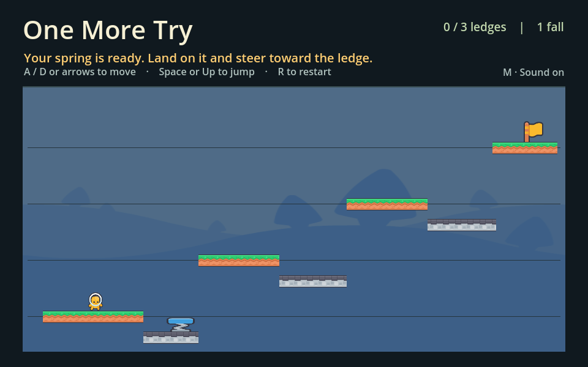

# One More Try

A short Godot platformer about using setbacks to climb. Drop into a well to leave a spring at the point where you landed. The game sends you back to the checkpoint. On your next attempt, land on the spring and steer right toward the higher ledge. Reach the flag to win. The shortest route takes three falls.

| Action | Keys |
| --- | --- |
| Move | A / D or Left / Right |
| Jump | Space or Up |
| Restart | R |
| Toggle audio | M |

## Play locally

Import `project.godot` into Godot 4.5.1 and press **F5**. For the browser version, extract the Web ZIP and serve that folder over HTTP. For example, run `python -m http.server 8000 --bind 127.0.0.1` from the extracted folder and open `http://127.0.0.1:8000`. Click the game for keyboard focus and browser audio. Keep the Web files together when hosting.

To rebuild, open **Project → Export**, select **Web**, and export to `export/web/index.html`. Use the templates for your version of Godot. Keep the Compatibility renderer and single-threaded Web preset.

## Editing

`run.tscn` contains the level and HUD. `player.gd` contains movement and collision handling. `run.gd` handles the spring, checkpoints, and restart. The files in `art` and `audio` are already wired up and can be replaced under the same names.

The art and sound effects are from Kenney's New Platformer Pack, and the music is Kistol's “Forget Me Not.” See `CREDITS.txt` for source files and license information.
